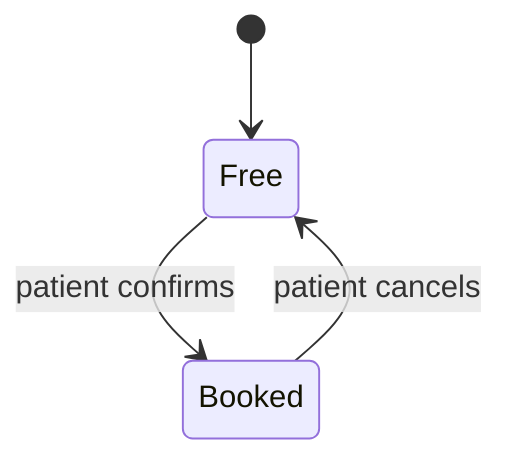

## Appointment lifecycle model

**Purpose:** show the states of an appointment so the team can check the rules.
**Audience:** developers and testers.
**Scope:** in: booking and cancelling. Out: reminders and the audit log.

**Open questions:** how does US-04 (move an appointment) change the states? It has no acceptance criteria yet.
