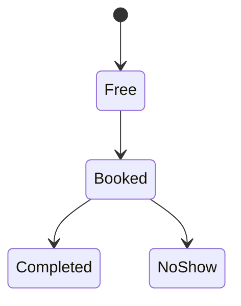

## Appointment model

Physical schema: appointment(appointment_id PK, slot_id FK, status) and slot(slot_id PK, doctor_id FK).

New rule BR-05: a completed appointment cannot be cancelled. New rule BR-06: a no-show blocks the patient for seven days.
