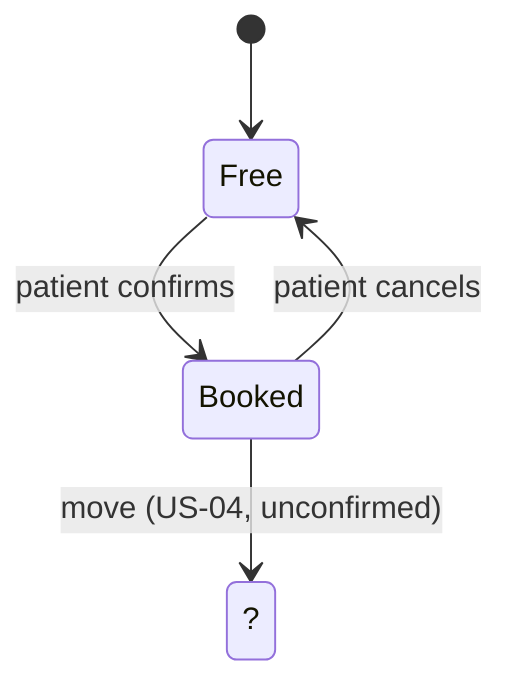

## Appointment state model (conceptual)

I did not invent states, and I have not drawn a physical schema yet. The package gives no states, so the diagram holds only what the stories imply, and the missing parts are marked with ?. Keys and indexes belong to the implementer. Do you want the physical schema anyway, and who will decide the tables and keys? Until you confirm, the data model stays conceptual.

**Open questions:** 1. Which other states exist? 2. What does a move do to the old slot?
