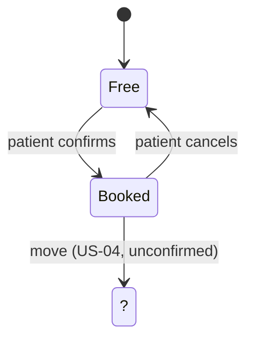

## Appointment state model (conceptual)

I did not invent states or a physical schema. The package gives no states, so the diagram holds only what the stories imply, and the missing parts are marked with ?. Keys and indexes belong to the implementer; the BA model stops at the conceptual level.

**Open questions:** 1. Which other states exist? 2. What does a move do to the old slot?
