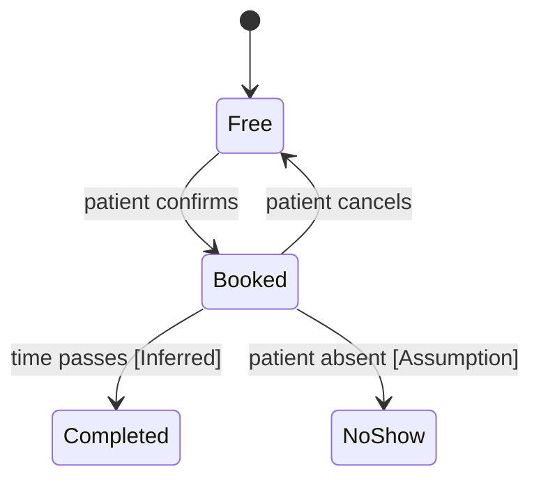

## Appointment state model and physical schema

The package gives no states, so the diagram holds what the stories imply. Every state or rule that the package does not contain is marked [Inferred] or [Assumption].

Physical schema (you asked for it; it follows the model above):

| Table | Columns |
|---|---|
| appointment | appointment_id PK, slot_id FK, patient_id FK, status |
| slot | slot_id PK, doctor_id FK, starts_at |

Proposed rule BR-05: a completed appointment cannot be cancelled [Assumption].

**Open questions:** 1. Which states beyond free and booked really exist? 2. Does a move (US-04) create a new appointment or change the old one?
