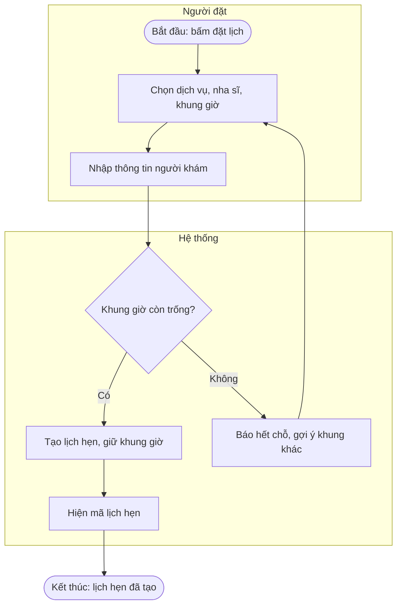
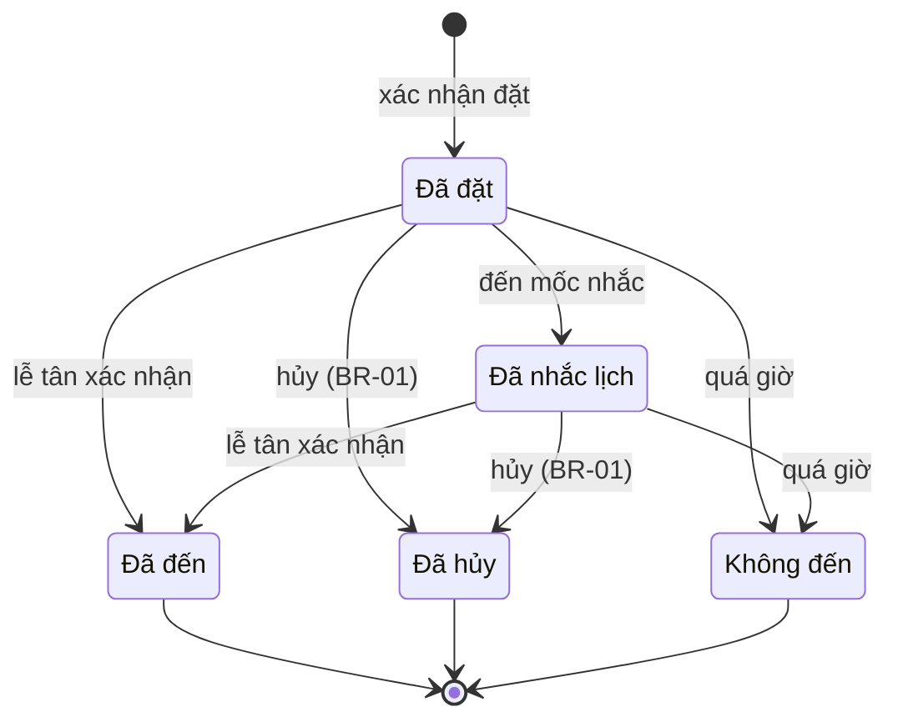
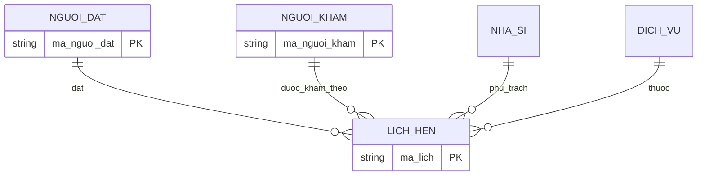

# Ví dụ mô hình (minh họa tự soạn, bối cảnh giả định: đặt lịch phòng khám; không phải kết quả từ khách hàng thật)

Ký hiệu Mermaid chỉ là lựa chọn công cụ để vẽ nhanh trong chat và tài liệu; BABOK không quy định ký hiệu này. Khi đội dùng BPMN/UML chuẩn hoặc công cụ riêng, mô tả bằng bảng và để người dùng vẽ lại.

## 1. Quy trình (to-be), có làn theo vai trò
Sự kiện kích hoạt: bệnh nhân bấm đặt lịch. Kết quả: lịch hẹn được tạo, hoặc bệnh nhân biết hết chỗ.

## 2. Trạng thái của thực thể "Lịch hẹn"

Bảng trạng thái tương ứng (dùng để khai thác với chuyên gia trước khi vẽ):
| Trạng thái đầu | Sự kiện | Điều kiện | Hành động | Trạng thái cuối |
|---|---|---|---|---|
| (mới) | Người đặt xác nhận | Khung giờ còn trống | Tạo lịch, giữ khung | Đã đặt |
| Đã đặt | Hủy | Đúng hạn theo BR-01 | Giải phóng khung giờ | Đã hủy |
| Đã đặt | Đến mốc nhắc | | Gửi nhắc lịch | Đã nhắc lịch |
| Đã đặt hoặc Đã nhắc | Quá giờ hẹn | Không ai xác nhận đến | Ghi nhận không đến | Không đến |

## 3. Mô hình dữ liệu mức khái niệm

Cách đọc: mỗi lịch hẹn liên quan đúng một người đặt, một người khám, một nha sĩ, một dịch vụ; một người đặt có thể có không hoặc nhiều lịch hẹn.

## 4. Từ điển dữ liệu (một dòng)
| Tên phần tử | Bí danh | Giá trị/ý nghĩa | Mô tả | Kiểu |
|---|---|---|---|---|
| Họ tên người khám | Tên bệnh nhân | Tối thiểu 2 ký tự (chờ xác nhận) | Tên đầy đủ người ngồi ghế | Nguyên thủy |
| Người khám | | = Họ tên người khám + Ngày sinh | | Hợp thành |

## 5. Bảng quyết định (ví dụ chống đặt quá hạn; ngưỡng là giả định cần chốt)
| Điều kiện: Khung giờ còn trống | Điều kiện: Người khám đã có lịch cùng giờ | Kết quả |
|---|---|---|
| Có | Không | Tạo lịch hẹn |
| Có | Có | Từ chối: trùng lịch người khám |
| Không | (bỏ qua) | Báo hết chỗ |
Kiểm: mọi tổ hợp điều kiện đã có một dòng (2 điều kiện, ô "bỏ qua" gộp hai tổ hợp), không dòng nào chồng lấn.

## 6. Mô tả use case (dạng bảng)
| Mục | Nội dung |
|---|---|
| Tên | Đặt lịch khám |
| Mục tiêu | Người đặt có lịch hẹn xác nhận với đúng nha sĩ và khung giờ |
| Tác nhân chính / phụ | Người đặt / (dịch vụ gửi tin nhắn nếu có) |
| Tiền điều kiện | Người đặt mở được trang đặt lịch |
| Kích hoạt | Người đặt bấm "Đặt lịch" |
| Luồng chính | 1. Chọn dịch vụ. 2. Chọn nha sĩ và khung giờ. 3. Nhập thông tin người khám. 4. Xác nhận. 5. Hệ thống tạo lịch và hiện mã |
| Luồng thay thế | 3a. Đặt cho người khác: nhập thêm thông tin người khám |
| Luồng ngoại lệ | 4a. Khung giờ vừa hết: báo và quay lại bước 2 |
| Hậu điều kiện thành công | Lịch hẹn tồn tại, khung giờ không còn trống |
| Đảm bảo tối thiểu | Không tạo hai lịch hẹn cùng khung giờ cho một nha sĩ |

## 7. Ma trận vai trò và quyền (CRUD)
| Hoạt động | Người đặt | Lễ tân | Nha sĩ | Quản trị |
|---|---|---|---|---|
| Tạo lịch hẹn | C | C | | |
| Xem lịch hẹn | R (của mình) | R | R (của mình) | R |
| Sửa/hủy lịch hẹn | U (theo BR-01) | U | | U |
| Xem ghi chú răng miệng | | ? | ? | ? |
Ô "?" là câu hỏi mở, không tự điền.

## 8. Ví dụ phạm vi (trong/ngoài)
| Trong phạm vi | Ngoài phạm vi (cố ý) |
|---|---|
| Đặt, hủy, đổi lịch | Thanh toán online (chờ quyết định) |
| Nhắc lịch qua Zalo | Hồ sơ bệnh án đầy đủ |
