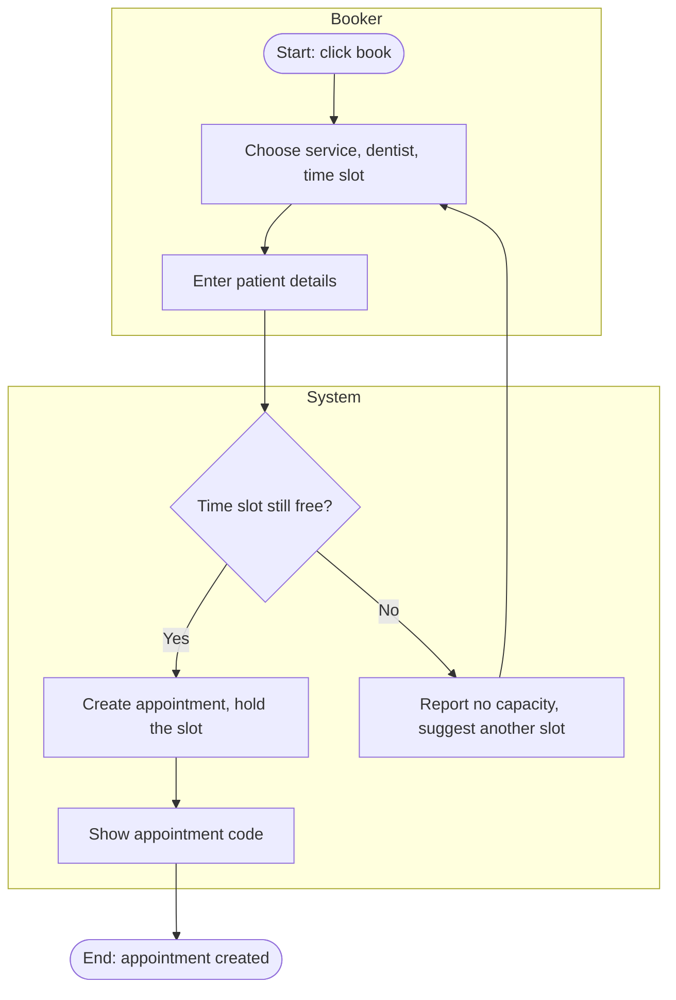
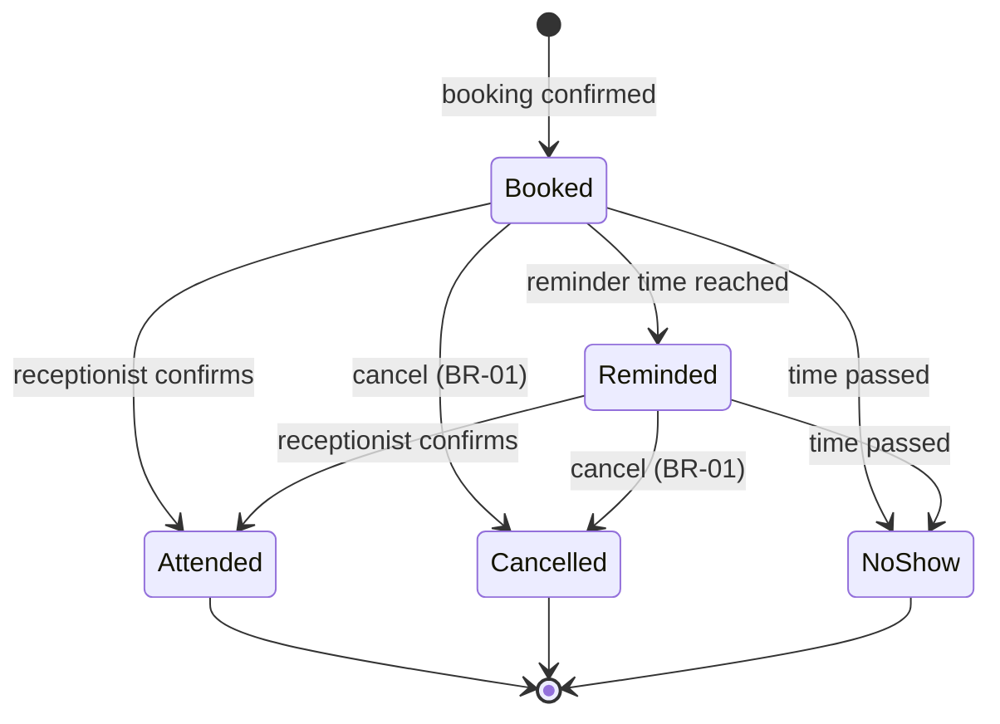
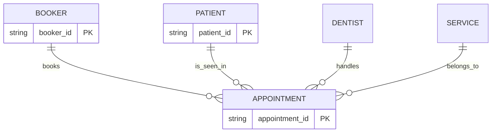

# Model examples (composed for illustration, assumed context: booking a clinic appointment; not results from a real customer)

The Mermaid notation is only a tool choice for quick drawing in chat and documents; BABOK does not prescribe it. When the team uses standard BPMN/UML or its own tool, describe with tables and let the user redraw.

## 1. Process (to-be), with lanes by role
Triggering event: the patient clicks to book. Outcome: the appointment is created, or the patient learns there is no capacity.

## 2. States of the entity "Appointment"

The corresponding state table (use it to elicit from experts before drawing):
| Initial state | Event | Condition | Action | Final state |
|---|---|---|---|---|
| (new) | Booker confirms | Time slot still free | Create appointment, hold the slot | Booked |
| Booked | Cancel | Within the deadline per BR-01 | Release the time slot | Cancelled |
| Booked | Reminder time reached | | Send the reminder | Reminded |
| Booked or Reminded | Appointment time passed | No one confirmed attendance | Record no-show | NoShow |

## 3. Conceptual data model

How to read it: each appointment relates to exactly one booker, one patient, one dentist and one service; one booker can have zero or many appointments.

## 4. Data dictionary (one row)
| Element name | Alias | Values/meaning | Description | Type |
|---|---|---|---|---|
| Patient full name | Patient name | At least 2 characters (awaiting confirmation) | Full name of the person in the chair | Primitive |
| Patient | | = Patient full name + Date of birth | | Composite |

## 5. Decision table (example for avoiding double booking; the threshold is an assumption to be fixed)
| Condition: Time slot still free | Condition: Patient already has an appointment at the same time | Result |
|---|---|---|
| Yes | No | Create the appointment |
| Yes | Yes | Reject: patient's appointment clash |
| No | (don't care) | Report no capacity |
Check: every combination of conditions has a row (2 conditions, the "don't care" cell merges two combinations), no rows overlap.

## 6. Use case description (table form)
| Item | Content |
|---|---|
| Name | Book a dental appointment |
| Goal | The booker has a confirmed appointment with the right dentist and time slot |
| Primary / secondary actors | Booker / (messaging service, if any) |
| Precondition | The booker can open the booking page |
| Trigger | The booker clicks "Book" |
| Main flow | 1. Choose a service. 2. Choose a dentist and a time slot. 3. Enter patient details. 4. Confirm. 5. The system creates the appointment and shows the code |
| Alternative flow | 3a. Booking for someone else: enter the patient's details as well |
| Exception flow | 4a. The time slot has just been taken: inform and return to step 2 |
| Success postcondition | The appointment exists, the time slot is no longer free |
| Minimal guarantee | No two appointments are created for the same time slot for one dentist |

## 7. Role and permission matrix (CRUD)
| Activity | Booker | Receptionist | Dentist | Admin |
|---|---|---|---|---|
| Create appointment | C | C | | |
| View appointment | R (own) | R | R (own) | R |
| Edit/cancel appointment | U (per BR-01) | U | | U |
| View dental notes | | ? | ? | ? |
A "?" cell is an open question; do not fill it in.

## 8. Scope example (in/out)
| In scope | Out of scope (deliberate) |
|---|---|
| Book, cancel, reschedule | Online payment (awaiting decision) |
| Reminders via a messaging app | Full medical records |
